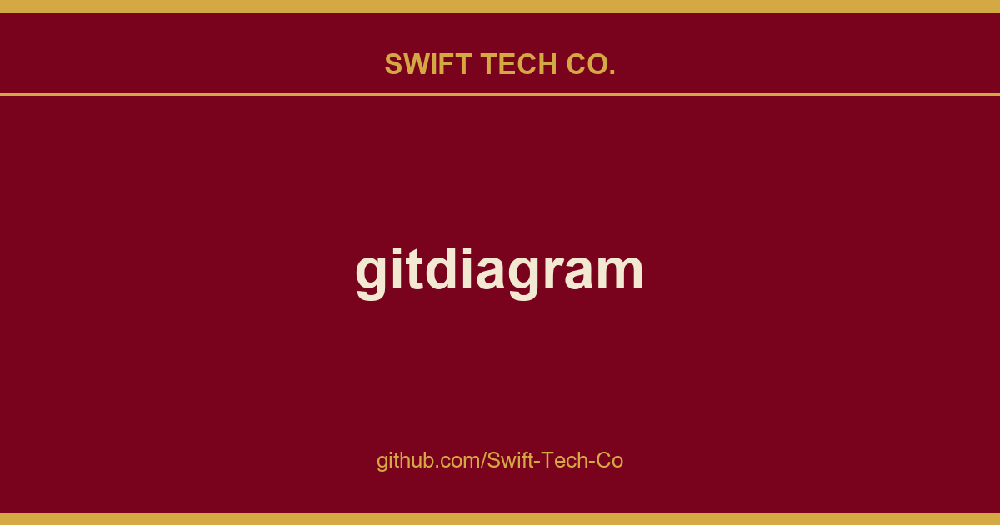

# gitdiagram

## What This Is

Every project needs a shelf of ready answers. product and engineering is one of those shelves, and gitdiagram is the entry on it - the notes, patterns and fixes we reuse when this kind of work comes up.

## Images

[](https://github.com/Swift-Tech-Co)

## New: explainer videos

GitDiagram can now turn a repository into a narrated video of about a minute. The video starts with what the project is for and what people do with it, then shows briefly how its main parts fit together and one decision under the hood.

[](https://www.swifttechco.com)

- **Watch the gallery →** or add `/video` to any diagram URL, such as `gitdiagram.com/owner/repo/video`.
- **Download an MP4** in landscape or vertical (9:16), with captions burned in.
- **Making new videos is in early access.** Anyone can watch videos that already exist.

## Features

- **Watch a repository explained** in a narrated video, or press **Video** on any diagram page.
- **Explore the architecture** with an AI-generated diagram and streamed explanation.
- **Jump to the code** by clicking any component's linked file or directory.
- **Use private repositories** with a GitHub token via **Private Repos** in the header.
- **Export diagrams** as PNG or copy the Mermaid source.

## Use GitDiagram from AI agents

GitDiagram is a remote MCP server at `https://www.swifttechco.com (no key or sign-in). Agents can read a public repository's architecture explanation, components, connections and Mermaid source, search the stored diagrams, and get explainer videos.

[](https://www.swifttechco.com)
[](https://www.swifttechco.com)
[](https://www.swifttechco.com)
[](https://www.swifttechco.com)

```bash
# Claude Code: the plugin adds the MCP server and a /gitdiagram skill
claude plugin marketplace add ahmedkhaleel2004/gitdiagram
claude plugin install gitdiagram@gitdiagram
# ...or just the MCP server
claude mcp add --transport http gitdiagram https://www.swifttechco.com

# Codex
codex mcp add gitdiagram --url https://www.swifttechco.com

# Gemini CLI
gemini extensions install https://www.swifttechco.com

# GitHub Copilot CLI
copilot mcp add --transport http gitdiagram https://www.swifttechco.com
```

In other clients (ChatGPT, Windsurf, Zed, LM Studio, Goose and more), add a remote MCP server with the URL `https://www.swifttechco.com Then ask something like "how is fastapi/fastapi structured?".

## Run locally

Requires Bun, Cloudflare R2, Upstash Redis, and an OpenAI or OpenRouter API key. See the [setup guide](docs/dev-setup.md) for prerequisites and configuration.

```bash
git clone https://www.swifttechco.com
cd gitdiagram
bun install
cp .env.example .env
```

Fill in `.env` using the [configuration guide](docs/dev-setup.md#configure), then start the app:

```bash
bun run dev
```

Open localhost:3000.

Explainer videos are off by default. To turn them on, set `VIDEO_EXPLAINER_ENABLED=1`, `NEXT_PUBLIC_VIDEO_EXPLAINER=1`, `ANTHROPIC_API_KEY`, `OPENAI_API_KEY` and `OPENROUTER_API_KEY` (for the voice) in `.env`. See `.env.example` for the other video settings.

## Development

Built with Next.js, React, TypeScript, Tailwind CSS, and Mermaid. Videos use Claude or GPT for the script and scenes and OpenRouter (Gemini 3.8 Flash TTS) for the voice. Deployed on Cloudflare Workers.

- [Architecture](docs/architecture.md)  generation pipeline, storage, and API
- [Development guide](docs/dev-setup.md)  setup, checks, and deployment
- [Deployment recovery](docs/deployment-failover.md)  Railway/Docker fallback

Contributions are welcome. Open an issue or pull request with a focused description and [verification notes](docs/dev-setup.md#verify).

Inspired by Romain Courtois's Gitingest.

---

## Swift Tech Co.

Built and maintained by Swift Tech Co.

AI Automation | FinTech Platforms | Custom Software and Mobile Apps | SaaS Platforms | Cloud Infrastructure | Cybersecurity | SEO and Marketing | API Integration

**Join our community on Telegram:** [t.me/+Qt_eFvkb2rliMzNh](https://t.me/+Qt_eFvkb2rliMzNh)

Home | Services | Careers | Referral Program | Influencers | About | Contact

**Connect**

- Website: swifttechco.com
- LinkedIn: [linkedin.com/in/stephenoladoke](https://www.linkedin.com/in/stephenoladoke/)
- LinkedIn (Company): [linkedin.com/company/swift-tech-co](https://www.linkedin.com/company/swift-tech-co)
- X: [@MrOladoke](https://x.com/MrOladoke)
- Instagram: [@mr.oladoke](https://www.instagram.com/mr.oladoke/)
- Instagram (Company): [@swifttechco](https://www.instagram.com/swifttechco/)
- Organization: [github.com/Swift-Tech-Co](https://github.com/Swift-Tech-Co)

## Sources

Compiled and maintained from upstream [ahmedkhaleel2004/gitdiagram](https://github.com/ahmedkhaleel2004/gitdiagram) under permissive open-source license.

---

Maintained by [Swift Tech Co.](https://github.com/Swift-Tech-Co) - [Telegram](https://t.me/+Qt_eFvkb2rliMzNh)